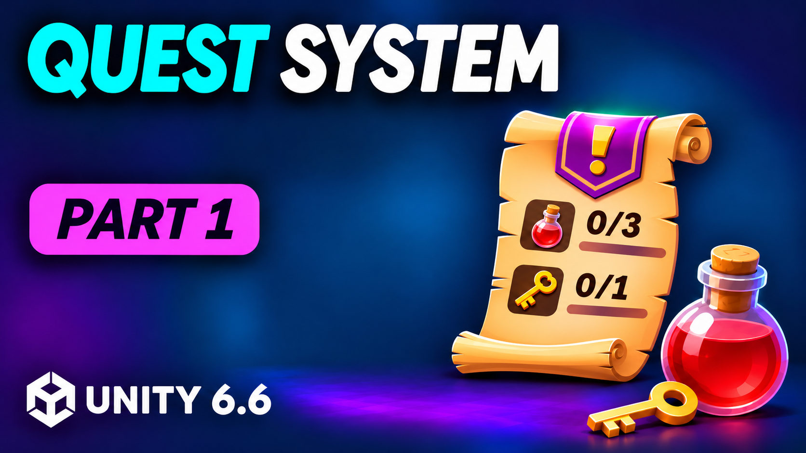

# Build a Quest System in Unity 6
## Part 1: Create and Accept Quests

In this tutorial, you will learn how to build the foundation of a quest system using ScriptableObjects, the factory pattern, and an event bus. By the end, you will be able to define objectives and rewards, let the player accept a quest from an NPC, and display its objectives in an on-screen tracker.

## Course

This tutorial is part of the **Build a Quest System in Unity 6** series. Build a quest giver and tracker, track pickups and turn in quests, then save and load quest progress.

Check out the other parts:

| Part | Topic | Repository |
| ---- | ----- | ---------- |
| **1** | **Create and Accept Quests** | *You are here* |
| 2 | Tracking Pickups and Turning In Quests | Coming soon |
| 3 | Saving and Loading Quest Progress | Coming soon |

## What's Included

- [`Quests/`](Quests/) - The scripts from `Assets/Scripts/Gameplay/Quests`, with their folder structure preserved.

These scripts use the demo's existing event bus, inventory, interaction, input and quest UI code, plus the SerializeReference Extensions package. They are companion code, rather than a standalone Unity project.

## Resources

- [Art Assets by Kay Lousberg](https://af.unity.com/ot/0eyX99W/)
- Unity Serialize Reference Extensions: https://github.com/mackysoft/Unity-SerializeReferenceExtensions

Note: These are affiliate links, which means if you purchase through them, I earn a small commission at no extra cost to you. That includes purchases of anything else, not just what I've linked. It helps me fund making new tutorials.
